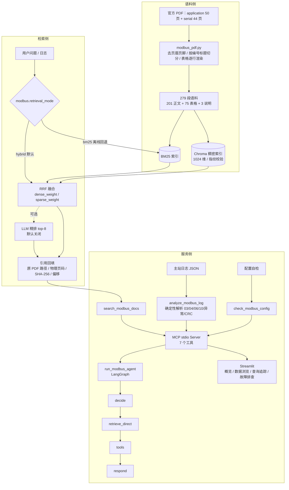

# Modbus RTU 技术文档与故障排查助手

个人项目，基于开源 RAG 框架二次开发。复用其混合检索、重排、摄取、MCP 与追踪能力，新增 Modbus 协议领域的语料治理、评测体系、诊断 Agent 与工程化收尾。

---

## 一页纸摘要

| 项目 | 内容 |
|---|---|
| **要解决的问题** | 工业现场排查 Modbus 通信故障时，需要同时查协议规范、设备手册、分析报文日志，人工翻阅效率低且容易漏读条款 |
| **做了什么** | 把两份官方 Modbus 规范治理成可检索语料（279 段），提供带原文页码引用的问答、确定性日志分析、配置核对，并封装成 7 个 MCP 工具，外加一个 LangGraph 诊断 Agent |
| **核心结果** | 检索留出集 Hit@3：BM25 0.514 → **hybrid 0.743**（v3，100 题）；Agent 端到端 6 个场景 5/6 通过机械检查 |
| **工程状态** | 1455 个单测全绿、GitHub Actions CI 通过、依赖锁定可复现 |
| **我的贡献边界** | 见下文「贡献边界」，可逐个文件追溯 |

> 所有数字均为**本地开发评测**，题目由本项目的 AI 助手编写并自审，**未做独立人工盲审**，不构成对外准确率声明。

---

## 架构与数据流



**关键设计取舍**

- 检索只取**混合排序的 chunk 顺序**，正文与页码仍从本地 corpus 回填——避免索引里的元数据与语料不一致。
- 默认 `hybrid`；`bm25` 作为离线回退保留。稠密索引缺失或指纹过期时**报错并给出修复命令**，不静默降级。
- 日志分析是**纯确定性代码**（不调用模型），Agent 只在需要解释协议规则时才检索文档。

---

## 30 秒复现

```bash
git clone https://github.com/equinox1234/MODULAR-RAG-MCP-AGENT
cd MODULAR-RAG-MCP-AGENT
uv sync --extra dev

uv run pytest            # 1455 passed，全部离线，约 25 秒
uv run ruff check .      # 正确性门禁
```

领域数据与评测集的生成：

```bash
uv run python -m scripts.ingest_modbus_docs          # PDF → 语料
uv run python -m scripts.build_modbus_dense_index    # 构建稠密索引（需 embedding 凭据）
uv run python -m scripts.validate_modbus_eval_suite  # 校验 100 道题的标签
uv run python -m scripts.evaluate_modbus --mode retrieval --retrieval-mode hybrid --split test
```

> `data/`（语料、PDF、评测产物）不入库。重新生成需要两份官方 Modbus 规范 PDF 与 embedding API Key，见 `data/modbus/README.md`。

---

## 里程碑与完成状态

按时间正序。详细的技术决策、踩坑与代价见 [TECH_NOTES.md](TECH_NOTES.md)（30 余条编号记录）。

| 日期 | 里程碑 | 结果 | 证据 |
|---|---|---|---|
| 11-04 | 日志解析与协议事实 | 单帧解析（03/04/06/10、异常、CRC）、配对、超时、广播；确定性分析入口 | `src/core/modbus_log.py`、`src/core/modbus_facts.py` |
| 11-05 | 正文入库与引用 | PDF → 按页分块，引用带原路径、物理页码、SHA-256、页内偏移 | `data/modbus/pdf_verified_answer.json` |
| 11-05 | LangGraph Agent | 决策/工具/证据回答循环，6 步上限、重复动作拦截、格式纠正、引用编号检查 | `src/core/modbus_agent.py` |
| 11-05 | 版本化评测基线 | 12 道检索 + 6 个 Agent 场景；检索 v1.1 = 10/11 Hit@3 | `data/modbus/evaluation/BASELINE_REVIEW.md` |
| 11-06 | MCP 接入 | 保留 3 个原工具，新增 4 个领域工具；真实客户端完成 4 个工具调用 | `data/modbus/mcp_agent_demo.json` |
| 11-07 | Streamlit 故障排查页 | 模拟/上传日志、确定性分析、检索、Agent 调用、证据展开、PDF 与 JSON 下载 | `data/modbus/DASHBOARD.md` |
| 11-08 | 语料治理与新分块 | 去页眉页脚/目录噪声；按编号标题切分；表格逐行成段。178 → **279 段** | `src/ingestion/modbus_pdf.py` |
| 11-08 | 混合检索 | `retrieval_mode` 双模式 + 稠密索引 + 指纹校验；v2 留出 Hit@3 0.550 → **0.800** | `src/core/modbus_knowledge.py` |
| 11-08 | 评测集 v2 → v3 | 60 题 → **100 题**（65 调参 / 35 留出），anchor 机械校验 | `tests/fixtures/modbus_eval_v3.json` |
| 11-08 | 精排对比 | LLM rerank 留出 Hit@3 0.800 → 0.900，但 +20~36 秒/次且有跨批次波动 → **默认关闭** | T-5 |
| 11-08 | 题目自审 | 100 题审阅：93 通过 / 7 修改 / 0 删除（含 1 处事实错误） | `V3_REVIEW_REPORT.md` |
| 11-08 | 工程收尾 | CI 门禁、测试分层、14 个长期失败清零、trace 治理、Dashboard 缓存 | T-7 / T-8 / T-9 |

---

## 评测结果

### 检索（v3，100 题）

| 划分 | 指标 | BM25 | Hybrid | Hybrid + Rerank |
|---|---|---|---|---|
| 调参（64 证据题） | Hit@3 | 0.641 | **0.703** | 未重跑 |
| 调参 | MRR@3 | 0.513 | **0.586** | 未重跑 |
| 留出（35 题） | Hit@3 | 0.514 | **0.743** | 未重跑 |
| 留出 | MRR@3 | 0.443 | **0.633** | 未重跑 |

rerank 的数字来自 v2（60 题）：留出 Hit@3 0.800 → 0.900，调参 MRR 0.756 → 0.786。**默认关闭**，原因是每次查询多一次模型调用（约 20–36 秒）且跨批次结果不完全可复现。

### 版本对比（为什么扩到 100 题）

| 套件 | 留出集 BM25 Hit@3 | 留出集 Hybrid Hit@3 |
|---|---|---|
| v2（60 题） | 0.550 | 0.800 |
| v3（100 题） | 0.514 | 0.743 |

新题让 BM25 的绝对分明显下降，说明**旧题对稀疏检索过于友好、高估了系统能力**；hybrid 相对领先幅度基本不变（+25 pt → +23 pt），说明结论不是小样本特例。

### Agent（6 个场景）

| 用例 | 状态 | 模型调用次数 | 机械检查 |
|---|---|---|---|
| A01 信息不足追问 | needs_input | 1 | 通过 |
| A02 捕获末尾 pending | completed | 4 | 通过 |
| A03 异常响应 | completed | 4 | 通过（修复前 `budget_exhausted`） |
| A04 CRC + 超时 | completed | 4 | 通过 |
| A05 广播 | completed | 4 | 仅证据页检查失败（见已知限制） |
| A06 纯文档题 | completed | 4 | 通过 |

---

## 贡献边界

本项目**不是从零编写**，而是在开源 RAG 框架基础上做领域落地。下面的划分可按文件追溯：

**本项目的核心产出**

| 模块 | 文件 |
|---|---|
| Modbus 语料治理与新分块 | `src/ingestion/modbus_pdf.py` |
| 日志解析与协议事实 | `src/core/modbus_log.py`、`modbus_facts.py`、`modbus_config.py` |
| 双模式检索与精排接入 | `src/core/modbus_knowledge.py`、`modbus_dense.py` |
| 诊断 Agent | `src/core/modbus_agent.py` |
| 领域工具与 MCP 封装 | `src/mcp_server/tools/modbus_tools.py` |
| 页面 | `src/observability/dashboard/pages/modbus_assistant.py` |
| 评测体系 | `tests/fixtures/modbus_eval_v2.json`、`v3.json`、`scripts/evaluate_modbus.py`、`validate_modbus_eval_suite.py`、`make_modbus_review_sheet.py` |
| 工程化 | `.github/workflows/ci.yml`、`tests/conftest.py`、`pyproject.toml` 依赖锁定、`src/core/trace/` |

**复用框架的部分**：摄取流水线骨架、向量库与 BM25 实现、HybridSearch/RRF、LLM 与 embedding 适配器、MCP Server 骨架、Streamlit 导航、日志/trace 基础设施。

---

## 面试问答备忘

**Q：为什么默认用 hybrid 而不是 BM25？**

BM25 在留出集上 Hit@3 只有 0.514，hybrid 0.743。但代价是每次查询要多一次 embedding 调用，且需要事先构建稠密索引。所以保留 `bm25` 作为离线回退，并且**稠密索引缺失时直接报错并给出构建命令**——不静默降级，否则用户会以为自己在用 hybrid。

**Q：rerank 测出来有效，为什么默认关闭？**

留出集 Hit@3 从 0.800 提到 0.900，方向是对的。但它走 LLM，每次多 20–36 秒，并且**同一批查询分两次跑结果不一致**（R08 批量跑未命中，单独重跑两次都命中）。对 MCP 工具这种交互式场景，30 秒不可接受。所以做成开关，默认 false；真正的解法是本地 cross-encoder，但当前环境没有 torch，HuggingFace 也不可达。

**Q："准确率 74%"这个说法对吗？**

不对。0.743 是**检索命中的 Hit@3**，不是回答正确率。而且题目和标签都是我的 AI 助手写的，只做过自审——**没有独立人工盲审**。所以我的表述是"建了一套 100 题的检索评测集，hybrid 相对 BM25 在留出集上 +23 pt"，而不是"准确率 74%"。

**Q：遇到的最难的问题是什么？**

三个：

1. **文档身份混乱**：内容哈希和路径哈希混用，导致重新摄取时删除删错了文档。拆成 `doc_hash`（内容）与 `doc_scope`（路径），并做旧数据迁移。
2. **embedding 配置静默错误**：YAML 里留了个 `azure_endpoint` 字段，适配器因此走 Azure deployment 路径，全链路 404。单独跑 embedding 测试发现不了，是端到端跑通才暴露的。
3. **CI 装了 mcp 2.x 全红**：字段从 camelCase 改成了 snake_case。排查时发现 `uv.lock` **本身早就锁在坏版本**上，说明之前根本没人用锁文件装过。最后给依赖加上界 + CI 改用 `uv sync --frozen`。

---

## 已知限制与未完成

**明确未做**

- [ ] **独立人工盲审**：题目与标签由同一 AI 编写，自审不代表独立复核。留出集 35 题仍需他人抽查
- [ ] **Recall@K**：只算了 Hit@3 与 MRR@3，没算 Recall
- [ ] **rerank 在 v3 上未重跑**：其数字仍基于 v2（100 题约需 50 分钟）
- [ ] **架构图与演示视频**：本文件含 Mermaid 图，未做录屏
- [ ] **图片/图表检索**：用户确认延期，当前为纯文本 RAG

**已知弱项**

- hybrid 在**广播、关键字精确匹配**类问题上弱于 BM25（R08、A05 同源）。已用 rerank 验证方向，但未默认开启
- 分块粒度仍是瓶颈：同一页多个片段时，召回同页但不含答案的片段不算命中
- `mcp` 锁在 1.x，尚未迁移 2.x（字段命名变更）
- 集成测试缺凭据守卫，未纳入 CI（Q-8）
- ruff 只启用了正确性子集，完整规则集约 7000 处历史问题待分批清理（Q-7）

---

## 数据边界与合规

- 使用公开协议资料、允许使用的公开设备手册、自编虚拟设备说明和模拟日志；**不依赖公司内网文档、代码、日志或设备信息**。
- 模拟样例明确标记，不计入真实现场诊断有效性的证据。
- 自编说明标记为虚拟设备（VT-100），不冒充厂商手册。
- 公开资料来源、版本与获取方式登记在 `data/modbus/README.md`。
- 密钥不写入 YAML：`config/settings.yaml` 只引用环境变量（`${DASHSCOPE_API_KEY}`），真实值放 `.env`（已 gitignore）。

---

## 后续版本：图片与图表检索（已确认延期）

当前版本聚焦纯文本正文检索、日志分析与 Agent。图片能力留待后续：

- 提取 PDF 图片及图表区域，保存原图、页码、文档版本与来源
- 复用框架的 Image Captioning，用视觉模型生成可检索描述；按需补充 OCR
- 优先支持 Modbus 状态机图、RTU 时序图和接线图，保留文字、箭头与连接关系
- 描述与正文统一检索，回答引用原图；通过人工核对和专门评测检查图意

在真正完成并验证前，项目与简历均描述为**纯文本 RAG**。
